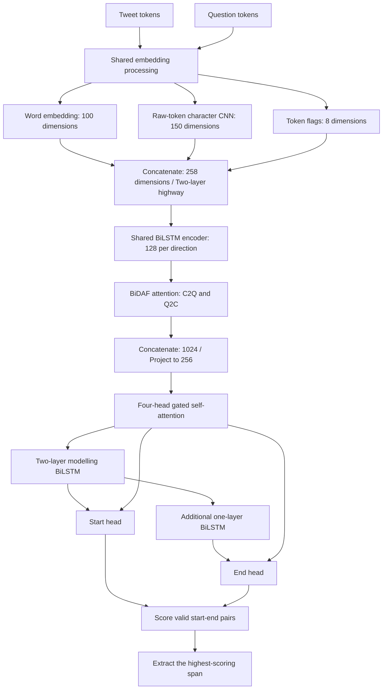
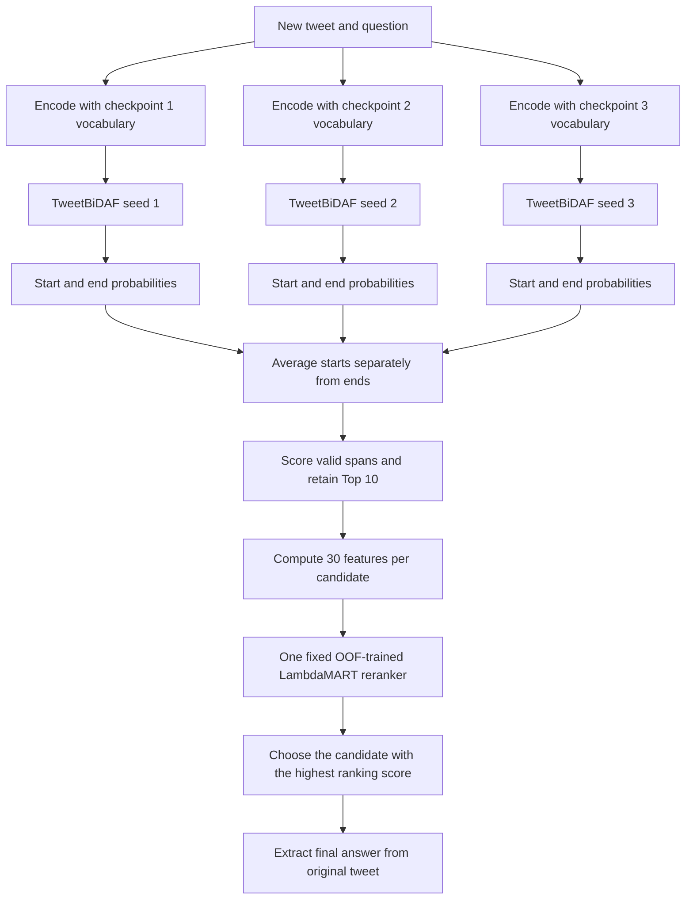

# TweetQA: Report Background and Experimental Findings

This document explains the dataset, model, experiments, and results. It is background material for the report, rather than the final six-page report. James's original branch ends at commit `fece41c`. The pointer-generator and reranking studies were added later on Kaz's branch. All performance numbers below are validation results, not final test results. Invented examples are explicitly labelled.

## 1. What does the original data look like?

Sources: [data report](C:/Users/kazut/Documents/ChatGPT/CITS4012/A2/results/DATA_REPORT.md), [data processing code](C:/Users/kazut/Documents/ChatGPT/CITS4012/A2/src/data.py), [saved split membership](C:/Users/kazut/Documents/ChatGPT/CITS4012/A2/results/splits.json), and [oracle evaluation script](C:/Users/kazut/Documents/ChatGPT/CITS4012/A2/scripts/stage1_oracle.py).

Each CSV row contains one question about one tweet and its gold answer. The columns are `Question`, `Answer`, `Tweet`, and `qid`.

An actual example from the dataset report:

| Field | Value |
|---|---|
| Question | where were the iraqi citizens trapped? |
| Answer | ['mount sinjar'] |
| Tweet | Rescued Yezidis aboard Iraqi Air Force helicopter that evacuated trapped civilians from Mount Sinjar Ivan Watson (@IvanCNN) August 11, 2014 |
| qid | Question identifier; its value is omitted here |

The original data contains text, not the numerical features used by our model. We create token flags and other model inputs during preprocessing.

`Answer` is a human-provided answer: the **gold answer**. It is stored as a string representation of an array and parsed into a list of strings. Training rows have one gold answer each; rows in the provided `test.csv` have two. A qid is not a unique tweet identifier: generic questions can repeat across different tweets.

```text
Illustrative tweet: "Tom visited Perth on Monday."
   ├── Who visited Perth?  → Gold: "Tom"
   ├── Where did Tom visit? → Gold: "Perth"
   └── When did Tom visit? → Gold: "Monday"

Keep all questions about the same tweet in the same split.
```

If questions were split independently, the model could see a tweet during training and answer another question about that same tweet during validation. We therefore split by tweet.

**This project uses an extractive span model as its main neural model.** A span is a continuous section of the tweet, which can contain one or more tokens. The model answers a question by predicting where that section starts and ends, then copying the corresponding original text. It does not write a new answer sentence.

For example, for the tweet `Tom visited Perth on Monday` and the question `Where did Tom visit?`, the desired span is the single token `Perth`. For a question about `Mount Sinjar`, the span could contain two tokens. The reason for choosing this approach is discussed in Section 4.2.

The gold answer does not directly specify a token position. We therefore automatically turn it into a **silver label**: the start and end positions of the best matching tweet span. In the simplified token sequence `[Tom, visited, Perth, on, Monday, .]`, gold `Perth` becomes start=2 and end=2, using zero-based positions. Gold remains the reference for evaluation; silver is the automatically derived training target. Section 1.4 gives the complete example.

### 1.1 Training, validation, and test sizes

```text
Provided train.csv
10,692 rows / 5,119 unique tweets
             │
             └── Remove 46 exact duplicate rows
                         │
                     10,646 questions
                         │
               Split by tweet, approximately 90:10
                  ┌──────┴──────┐
                  ▼             ▼
           Training          Validation
         9,570 questions    1,076 questions
             89.9%              10.1%
                  │
                  └── 8,057 meet the silver-label quality
                      requirement for span-model training

Provided test.csv: 1,086 rows / 583 unique tweets
Kept separately for final evaluation.
```

The configured validation fraction is 10% of tweet groups. Because tweets have different numbers of questions, the question-level fraction is approximately 10.1%. The split uses seed 4012 and stratifies tweet groups by the first question word of each tweet's first question.

The supplied files were `train.csv` and `test.csv`. We created our own **validation set** from `train.csv` and reserved `test.csv` for final evaluation. Use these project roles consistently throughout the report:

| Name in this report | Purpose |
|---|---|
| Training set | Learn model parameters. |
| Validation set | Select settings and checkpoints and investigate model behaviour. |
| Test set | Evaluate the frozen system at the end. |

The repository's data report calls the supplied `test.csv` the original public TweetQA “development set”, based on its size and format. This is background about the dataset's original naming, not a separate fourth split in our project. “Development” usually means “validation”. The report can omit that historical naming and simply say that the supplied `test.csv` was reserved as our final test set. This identification comes from the local data report, not an independently verified provenance check.

**Distinguish 9,570 from 8,057:** 9,570 is the size of the training partition. The extractive model trains on 8,057 examples whose best silver span has Token F1 of at least 0.5. Evaluation includes all 1,076 validation questions, including those without a good span.

In other words, **1,513 of the 9,570 training questions are excluded from span-model training after checking silver-label quality**. They remain part of the training partition, but the training DataLoader filters them out. For each question, the code searches for the best span. If no span has F1 ≥ 0.5 against gold, that question is not used to train the span model.

Illustrative examples: gold=`Perth` with an exact tweet span has F1=1 and is retained. Gold=`he was sick` in a tweet saying only `Tom felt ill` has no normalized word overlap and is excluded. Exclusion does not mean the human answer is wrong; it means our extractive training rule cannot obtain a sufficiently matching label.

The data report identifies four noisy annotation rows, but the split function does not explicitly remove those four rows. Do not claim that it does. The report also records three tweets shared between the supplied train and test files. The grouped split prevents train–validation tweet overlap; it does not establish that every supplied split is mutually disjoint.

These are two separate checks:

| Observation | Plain-English meaning | What we can claim |
|---|---|---|
| Four annotation-noise rows | Some rows have placeholder-like question/answer text such as `tweet does not exist`. | They were detected; explicit removal is not implemented in the split function. Silver-quality filtering may separately exclude unusable examples. |
| Three tweets occur in both supplied files | The same tweet text appears in `train.csv` and `test.csv`. | Our train–validation split has no shared tweets, but we cannot claim that the supplied train–test files have no overlap. |

The latter does not necessarily mean identical questions are repeated. It means tweet context overlaps. Before reporting final test results, document whether and how those overlaps were handled; do not silently change the evaluation protocol.

### 1.2 Important dataset properties

The original training-file statistics show median lengths of 32 tokens per tweet, 8 per question, and 2 per answer. Each tweet has about 2.09 questions on average. Many tweets include a trailing author name, handle, and date.

**The key observation is that only 64.8% of gold answers match a continuous tweet token sequence after normalization.** In roughly 65 out of 100 original training examples, the complete normalized answer can therefore be found as one continuous phrase. In the remaining roughly 35, the exact normalized phrase is absent.

Before this normalization, 57.5% are case-insensitive substring matches. These two checks differ: the normalized check also processes punctuation and articles and uses whole tokens. Both statistics describe the original training file, not only the 8,057 selected training examples. The 64.8% exact-match statistic is also different from the F1 ≥ 0.5 rule, which permits partially matching silver labels.

### 1.3 What does 64.8% mean?

The following are illustrative examples, not measured dataset rows.

| Tweet | Gold answer | Continuous match after normalization? | Reason |
|---|---|---|---|
| Tom lives in Perth. | perth | Yes | Lowercasing removes the case difference. |
| We visited the High School. | high school | Yes | Case and punctuation do not prevent a match. |
| Tom is twenty years old. | 20 | No | Normalization does not convert twenty into 20. |
| Tom stayed home because he felt ill. | he was sick | No | The answer paraphrases the tweet. |

Answer normalization lowercases text, replaces ASCII and Unicode punctuation with spaces, removes `a`, `an`, and `the`, and collapses whitespace. It does not resolve arbitrary paraphrases.

Therefore, about 35.2% lack an exact normalized continuous match. They may involve paraphrasing, non-contiguous information, or other surface differences. Do not assume that every unmatched answer belongs to the same error category.

### 1.4 From gold answers to silver spans

Gold gives an answer string. A span model needs a start and an end position. We automatically search tweet spans of up to 15 model tokens and compare them with gold using Token F1. We choose the highest-scoring span. Ties are resolved using ROUGE-L, shorter length, and earlier position.

```text
Illustrative tweet: "Citizens were trapped on Mount Sinjar."
Question: "Where were the citizens trapped?"
Human gold answer: "Mount Sinjar"

Simplified model tokens, with zero-based positions:
  0:Citizens  1:were  2:trapped  3:on  4:Mount  5:Sinjar  6:.
                 ↓ Automatic alignment using gold
Silver training label: start=4, end=5
                 ↓ Training
Teach the start head to choose 4 and the end head to choose 5
                 ↓ Prediction on a held-out question
Model receives tweet + question, without gold
Suppose it predicts start=4, end=5
                 ↓ Extract original text using character offsets
Predicted answer: "Mount Sinjar"
                 ↓ Compare with original gold
Normalized exact match: yes → EM=1 for this question
```

If the model instead predicts start=5, end=5, its answer is `Sinjar`. EM is 0, but Token F1 gives partial credit. A span is continuous and includes both boundary positions.

Silver labels can lose information when gold cannot be expressed as one continuous span. Automatic alignment can also choose an unsuitable position even when a good span exists. These are different limitations: the output format and label noise.

### 1.5 Extractive oracle

An **oracle** is a hypothetical selector that is allowed to see the correct answer. Here, it searches valid tweet spans using gold, selects the best F1 span with the stated tie-breaks, and evaluates that selected text.

Illustrative examples:

| Tweet | Gold | What the oracle can do |
|---|---|---|
| Tom lives in Perth. | Perth | Select `Perth` and achieve EM=1. |
| Tom felt ill. | he was sick | No span equals gold, so even a gold-aware selector cannot achieve EM=1. |

| Validation measure | Oracle score | Interpretation |
|---|---:|---|
| EM | 60.78 | About 60.78% can be answered exactly by the selected valid spans under this implementation. |
| ROUGE-L | 75.97 | Selected spans can also receive partial credit when exact matching is impossible. |

**Is this a performance cap?** For EM, it serves as an extractive ceiling under the same tokenization, valid-span rules, normalization, and gold matching. A model restricted to those spans cannot produce an exact answer where no matching valid span exists. It is not a universal cap on TweetQA: a generator can produce words absent from the tweet. ROUGE-L 75.97 is a diagnostic reference rather than a strict ROUGE-L maximum, because the selector primarily maximizes F1, not ROUGE-L independently.

The oracle uses gold to choose answers and cannot be deployed on questions with unknown answers. It separates the limitation of the span format from the model's ability to choose the right span.

## 2. Why choose a BiLSTM–BiDAF model?

Sources: [model code](C:/Users/kazut/Documents/ChatGPT/CITS4012/A2/src/model.py), [tuning decisions](C:/Users/kazut/Documents/ChatGPT/CITS4012/A2/scripts/stage4_select.py), [experiment log](C:/Users/kazut/Documents/ChatGPT/CITS4012/A2/results/PROGRESS.md), and [FastText training code](C:/Users/kazut/Documents/ChatGPT/CITS4012/A2/src/fasttext_init.py).

We chose a BiLSTM–BiDAF architecture because this task requires both contextual understanding of tweet tokens and explicit alignment between a tweet and its question. A span model must decide which tweet phrase answers this particular question, rather than simply finding an important phrase in the tweet.

For example, in `Tom visited Perth on Monday`, the answer should change from `Tom` to `Perth` to `Monday` depending on whether the question asks who, where, or when. BiLSTM supplies surrounding context, while BiDAF supplies question-dependent information at each tweet position. Character features and tweet-specific flags adapt this framework to informal text and author metadata.

The basic architecture was selected before tuning. Tuning adjusted its settings; it did not compare RNN, GRU, LSTM, and Transformer architectures.

A BiLSTM reads the sequence in both directions to give each token access to surrounding context. BiDAF attention connects tweet and question representations. Self-attention then mixes information between tweet tokens after question information has been incorporated.

The two uses of “bidirectional” differ:

- BiLSTM: forward and backward reading directions.
- BiDAF: context-to-question and question-to-context information flow.

BiLSTM was a design choice for contextual token representations under from-scratch training. It is not cheaper than a simple RNN or a same-width unidirectional LSTM. With the same hidden size per direction, the recurrent work is roughly doubled by bidirectionality. We did not directly compare alternative encoders, so we cannot claim that BiLSTM was empirically the best encoder.

### 2.1 Hyperparameter study

| Setting | Values tested | Meaning |
|---|---|---|
| Learning rate | 0.001, 0.0005 | Size of parameter updates |
| Hidden size | 96, 128, 192 | LSTM hidden dimensions per direction |
| Dropout | 0.2, 0.3 | Randomly suppresses features during training to reduce overfitting |
| Maximum span length | 10, 15, 20 | Maximum answer length in model tokens |
| Word initialization | Random, in-domain FastText | Initial word representations |

The study mainly changed one factor at a time rather than running every combination. A seed-1 variant was considered promising if its validation ROUGE-L exceeded the maximum of three baseline seeds. Promising learning-rate and FastText changes were checked over three seeds.

Initial screening used one seed and compared each change against the three-seed baseline range [39.68, 40.72].

| Single change from the tuning baseline | Seed-1 ROUGE-L | Decision |
|---|---:|---|
| Learning rate 0.0005 | 41.22 | Adopt for confirmation |
| In-domain FastText initialization | 40.96 | Adopt for confirmation |
| Hidden size 96 | 40.32 | Keep default 128 |
| Hidden size 192 | 40.32 | Keep default 128 |
| Dropout 0.3 | 40.40 | Keep default 0.2 |
| Maximum span length 10 | 40.49 | Keep default 15 |
| Maximum span length 20 | 40.12 | Keep default 15 |

| Three-seed confirmation | ROUGE-L |
|---|---:|
| Baseline: lr=0.001, random initialization | 40.19 ± 0.52 |
| Lower learning rate: lr=0.0005 | 41.00 ± 0.45 |
| Lower learning rate + in-domain FastText | **42.57 ± 0.84** |

**Conclusion:** the supported changes were a learning rate of 0.0005 and in-domain FastText initialization. Changing hidden size, dropout, or maximum span length did not exceed the baseline seed range in this screening, so their default values were retained. This is not proof that the retained settings are globally optimal. These tuning runs used soft targets and are distinct from the later main-model GPU runs.

The selected settings include hidden size 128, dropout 0.2, learning rate 0.0005, batch size 32, Adam, gradient clipping at 5, and maximum span length 15. Training runs for up to 30 epochs with early stopping on validation ROUGE-L, patience 4.

FastText uses only tweets and questions from the training partition to learn 100-dimensional vectors. It is not an externally pretrained embedding.

## 3. Main model architecture

Sources: [model implementation](C:/Users/kazut/Documents/ChatGPT/CITS4012/A2/src/model.py), [training implementation](C:/Users/kazut/Documents/ChatGPT/CITS4012/A2/src/train.py), [retraining notebook](C:/Users/kazut/Documents/ChatGPT/CITS4012/A2/step01_colab_v2_retrain.ipynb), and [selected configuration](C:/Users/kazut/Documents/ChatGPT/CITS4012/A2/results/FROZEN_CONFIG.json).



“Shared” means applying the same parameters to the tweet and question separately, not concatenating them into one input sequence.

### 3.1 How the model processes a question

**Word embeddings:** Map normalized words to 100-dimensional vectors.

These vectors are learned numerical descriptions of words. Similar useful patterns can be represented by similar vectors. In-domain FastText provides their initial values, which are then used by the QA model.

**Character CNN:** Read the lowercased raw characters of each token. Character embeddings have 32 dimensions. Convolutions of widths 3, 4, and 5 have 50 filters each. Max pooling produces a combined 150-dimensional representation.

The filters detect short character patterns. For unfamiliar names or handles, this branch can still provide spelling information when word lookup returns an unknown or normalized token.

**Eight token flags:** Mention, hashtag, URL, emoji, number, initial capital letter, membership in the author/byline region, and occurrence as a non-stopword in the other sequence.

These are explicit indicators. For example, `@Tom` has the mention flag, and a name in the trailing author region has the byline flag. They give the model structural clues beyond word identity.

**Highway layers:** Learn how much of the original representation to keep and how much transformed information to use.

The word, character, and flag vectors are first joined. Highway gates allow useful original features to pass through while also learning transformations of them.

**BiLSTM:** Combine forward and backward context into a 256-dimensional representation at each token.

For `Perth` in `Tom visited Perth on Monday`, its representation includes information from words before and after it. The same encoder parameters process tweet and question.

**BiDAF:** Compute the similarity between tweet position i and question position j:

$$
S_{ij}=\mathbf{w}^{\top}[\mathbf{h}_i;\mathbf{u}_j;\mathbf{h}_i\odot\mathbf{u}_j].
$$

C2Q gives each tweet position a weighted question representation. Q2C produces a weighted summary of tweet positions relevant to the question. Their combined representation is:

$$
\mathbf{G}_i=[\mathbf{h}_i;\mathbf{c}_i;\mathbf{h}_i\odot\mathbf{c}_i;\mathbf{h}_i\odot\mathbf{q}],
$$

where c is the C2Q representation and q is the Q2C context summary.

Here h_i is tweet token i, u_j is question token j, semicolons mean concatenation, and ⊙ means elementwise multiplication. C2Q asks which question words matter for each tweet position. Q2C summarizes tweet positions that strongly relate to the question. These are learned associations, not hand-written who/where rules.

**Gated self-attention:** First collect attended information, then calculate a gate and add the gated information:

$$
\mathbf{a}=\operatorname{MultiHeadAttention}(\mathbf{x},\mathbf{x},\mathbf{x})
$$

$$
\mathbf{g}=\sigma(\mathbf{W}[\mathbf{x};\mathbf{a}]+\mathbf{b})
$$

$$
\mathbf{y}=\operatorname{LayerNorm}(\mathbf{x}+\operatorname{Dropout}(\mathbf{g}\odot\mathbf{a})).
$$

The gate controls how much attended information is added.

Each tweet position can collect information from other tweet positions. The gate controls the amount added, the residual preserves the existing representation, and LayerNorm normalizes the combined features. The modelling BiLSTMs then process this enriched sequence before the output heads select boundaries.

**Start and end heads:** Produce distributions over tweet positions. Decode the valid pair:

$$
(\hat{i},\hat{j})=\underset{0\leq i\leq j<T,\;j-i+1\leq15}{\operatorname{argmax}}\;p_s(i)p_e(j),
$$

where T is the tweet length, p_s is the start distribution, and p_e is the end distribution. The implementation uses the equivalent sum of log probabilities.

Offsets preserve the connection to the original tweet, so predictions are extracted from the original text rather than reconstructed from normalized words.

There is no need for a separate v1-to-v2 history section in the report. Describe the final architecture and explain the choice of single-span supervision through the target comparison in Section 6. The tables retain `v2` only to identify the corresponding saved results.

## 4. Baselines and the decision to retain extraction

Sources: [original result tables](C:/Users/kazut/Documents/ChatGPT/CITS4012/A2/results/RESULTS.md), [original GPU notebook](C:/Users/kazut/Documents/ChatGPT/CITS4012/A2/step01a_gpu_runner.ipynb), [lexical baseline](C:/Users/kazut/Documents/ChatGPT/CITS4012/A2/src/baselines/b1_lexical.py), [BERTweet baseline](C:/Users/kazut/Documents/ChatGPT/CITS4012/A2/src/baselines/b3_extractive_ft.py), [T5 baseline](C:/Users/kazut/Documents/ChatGPT/CITS4012/A2/src/baselines/b4_t5_ft.py), and [Qwen baseline](C:/Users/kazut/Documents/ChatGPT/CITS4012/A2/src/baselines/b5_llm.py).

### 4.1 James's original validation results

| Model | Runs | BLEU-1 | METEOR | ROUGE-L | EM | F1 |
|---|---:|---:|---:|---:|---:|---:|
| TweetBiDAF v2 | 3 | 39.04 ± 0.09 | 33.31 ± 0.72 | 44.51 ± 0.11 | 27.94 ± 0.75 | 44.65 ± 0.11 |
| B1: lexical rules | 1 | 17.12 | 14.31 | 21.07 | 10.32 | 21.04 |
| B2: task-specific components off | 3 | 25.66 ± 0.22 | 23.62 ± 0.04 | 30.14 ± 0.29 | 15.95 ± 0.47 | 30.06 ± 0.30 |
| B3: BERTweet fine-tuning | 1 | 55.01 | 44.59 | 59.98 | 43.12 | 60.23 |
| B4: t5-small fine-tuning | 1 | 52.64 | 43.65 | 56.93 | 38.01 | 57.06 |
| B5: Qwen2.5-1.5B-Instruct, four-shot | 1 | 61.30 | 49.07 | 66.45 | 49.16 | 66.91 |

The custom model outperformed lexical rules and the stripped-down model but did not reach pretrained baseline performance. The assignment requires the main model to be trained from scratch; pretrained T5 or Qwen therefore cannot simply replace it as the main model.

### What does each comparison model do?

| Model | How it answers | Why include it? |
|---|---|---|
| TweetBiDAF | Learns from scratch to select tweet start/end positions using question–tweet attention and tweet-specific features. | The main model whose design is investigated. |
| B1: lexical rules | Scores short tweet windows using word-overlap rules and returns a selected phrase, without neural training. | Tests how much can be achieved through shallow lexical matching. |
| B2: stripped-down TweetBiDAF | Retains the basic recurrent span framework while disabling the task-specific options. | Measures the combined value of the added design choices. It is still a learned extractive model. |
| B3: BERTweet | Fine-tunes a pretrained tweet-oriented encoder with a span head. | Provides a pretrained extractive comparison suited to social-media language. |
| B4: t5-small | Fine-tunes a pretrained encoder–decoder to generate the answer from the question and context. | Tests a generative alternative that can output text absent from the tweet. |
| B5: Qwen2.5-1.5B-Instruct | Uses a fixed prompt with four demonstrations, without project-specific parameter training. | Tests an instruction-model approach using prompting rather than fine-tuning. |

Fine-tuning updates pretrained model weights. Four-shot prompting instead provides four examples in the input prompt; it does not update model weights. These approaches differ in pretraining, adaptation, and output format, so the table contextualizes performance rather than isolating one architectural factor. B3–B5 each have one run, so their seed variability was not established.

### 4.2 Why initially choose a span model?

Many answers are short, explicit phrases. Extraction preserves names and social-media expressions directly from the source. It restricts prediction to positions instead of generating words from an entire vocabulary. These are design motivations, not proof that extraction always trains better than generation.

### 4.3 A from-scratch generator was also tested later

Sources: [generator experiment notebook](C:/Users/kazut/Documents/ChatGPT/CITS4012/A2/step04a_colab_pointer_generator_experiment.ipynb), [generator report notebook](C:/Users/kazut/Documents/ChatGPT/CITS4012/A2/step04b_pointer_generator_results_report.ipynb), [generator model](C:/Users/kazut/Documents/ChatGPT/CITS4012/A2/src/generative.py), and [generator training code](C:/Users/kazut/Documents/ChatGPT/CITS4012/A2/src/train_generative.py).

Kaz's branch added a pointer-generator to investigate answers that cannot be copied as one span. This encoder–decoder mixes a vocabulary-generation distribution with an attention-based copy distribution at each output step. It is separate from James's pretrained T5 baseline.

| Pointer-generator validation subset | Questions | ROUGE-L | EM | F1 |
|---|---:|---:|---:|---:|
| All | 1,076 | 35.57 | 21.19 | 35.77 |
| Fully extractive | 659 | 49.70 | 34.45 | 49.69 |
| Partially/non-extractive | 417 | 13.24 | 0.24 | 13.77 |
| No good span | 191 | 2.88 | 0.52 | 3.14 |

These subsets use best-span F1 in the saved experiment. Their definition differs from the original 64.8% normalized-match statistic. The 191 no-good-span examples are included in the 417 partially/non-extractive examples; do not add these rows together.

The generator's overall ROUGE-L of 35.57 was below the historical extractive rerun mean of 44.22 ± 0.16. This particular generator was not adopted. It was a one-seed exploratory experiment with a different architecture, not a paired proof that all generative models are worse. Unknown-token outputs and inappropriate generated entities were also observed qualitatively.

Report narrative: identify extraction's limitation → test generation → find insufficient overall performance in this implementation → retain extraction and improve candidate selection.

## 5. What did each ablation test?

Sources: [ablation results](C:/Users/kazut/Documents/ChatGPT/CITS4012/A2/results/RESULTS.md), [v2 ablation notebook](C:/Users/kazut/Documents/ChatGPT/CITS4012/A2/step01b_gpu_runner_run2.ipynb), [model switches](C:/Users/kazut/Documents/ChatGPT/CITS4012/A2/src/model.py), and [ablation table script](C:/Users/kazut/Documents/ChatGPT/CITS4012/A2/scripts/stage5_tables.py).

Each condition below uses three seeds. These are James's original v2 results. Deltas were calculated before rounding.

| Condition | ROUGE-L | Change |
|---|---:|---:|
| Main v2 | 44.51 ± 0.11 | Reference |
| A1: no character CNN | 43.56 ± 0.39 | −0.94 |
| A2: no normalization or token flags | 32.82 ± 0.69 | −11.68 |
| A3: no gated self-attention block | 42.52 ± 0.84 | −1.99 |
| A4: no Q2C attention | 43.50 ± 0.70 | −1.01 |
| A5: wide soft targets | 42.95 ± 0.47 | −1.56 |

### A1: Character CNN

Hypothesis: character patterns help represent unfamiliar names and unusual spellings. For example, normalized word lookup maps both `@Alice` and `@Bob` to `<user>`, while the raw-character branch retains their spelling differences.

Remove only the character branch and retrain. The reduction supports its usefulness. It does not by itself show which specific examples were rescued by character features.

### A2: Tweet normalization and token flags

Normalization makes word lookup less sensitive to surface variation: handles become `<user>`, URLs `<url>`, emoji `<emoji>`, and hashtags split into `#` and their text. Repeated characters are shortened to two repeats; `Sooooo` becomes `soo`, not dictionary-normalized `so`. Raw characters and offsets remain available.

Flags explicitly mark information such as mentions, numbers, byline membership, and lexical overlap with the question. This ablation removes normalization and all eight flags together. The large drop supports their combined contribution, but cannot separate their individual effects.

### A3: Gated self-attention

Hypothesis: tweet tokens benefit from accessing other tokens, including distant author information, after incorporating the question.

Remove the entire self-attention block, keeping BiDAF and BiLSTMs. The drop supports the block's contribution. It does not isolate the gate's contribution, and parameter count also changes.

### A4: Q2C

Hypothesis: a question-relevant tweet summary adds useful information beyond giving each tweet token its own question summary.

Remove Q2C while keeping C2Q. This does not remove all attention. The v2 reduction is about one ROUGE-L point.

### A5: Supervision

Replace the v2 single-span target with wide soft targets. This changes the training target and loss rather than removing an architectural component.

Historical naming needs care: in the v1 experiments, A5 changed soft to single and became v2. In the v2 table, A5 means returning to wide soft supervision.

## 6. Single, narrow, medium, and wide supervision

Sources: [silver-label and target construction](C:/Users/kazut/Documents/ChatGPT/CITS4012/A2/src/data.py), [span loss](C:/Users/kazut/Documents/ChatGPT/CITS4012/A2/src/model.py), [target-width experiment notebook](C:/Users/kazut/Documents/ChatGPT/CITS4012/A2/step01b_gpu_runner_run2.ipynb), and [results](C:/Users/kazut/Documents/ChatGPT/CITS4012/A2/results/RESULTS.md).

Illustrative example: the tweet is `Independence High School`, and gold is the same three words.

| Candidate span | Token F1 against gold | Included in |
|---|---:|---|
| Independence High School | 1.00 | Narrow, medium, wide |
| Independence High | 0.80 | Medium, wide |
| High School | 0.80 | Medium, wide |
| Independence | 0.50 | Wide |
| High | 0.50 | Wide |
| School | 0.50 | Wide |

**Single:** choose only the best span. Teach start=`Independence` and end=`School`.

**Narrow:** include spans with F1 ≥ 0.85.

**Medium:** include spans with F1 ≥ 0.70.

**Wide:** include spans with F1 ≥ 0.50.

The number of candidates varies by question. Training averages were approximately 1.3 for narrow, 3.6 for medium, and 17.1 for wide. Narrow does not always mean exactly one candidate.

### 6.1 How soft targets are constructed

Candidate weights are proportional to F1:

$$
w_k=\frac{f_k}{\sum_{\ell\in\mathcal{C}}f_\ell},
$$

where C is the set of qualifying spans and f_k is candidate k's Token F1 against gold.

In the medium example, the total is 1 + 0.8 + 0.8 = 2.6. Candidate weights are approximately 0.385, 0.308, and 0.308. These weights are summed separately at each start and end position.

| Target | Start: Independence | Start: High | Start: School | End: Independence | End: High | End: School |
|---|---:|---:|---:|---:|---:|---:|
| Single | 1 | 0 | 0 | 0 | 0 | 1 |
| Medium | 0.692 | 0.308 | 0 | 0 | 0.308 | 0.692 |

Single supervision concentrates on one boundary pair. Medium supervision also rewards starting at `High` or ending at `High`. This can accommodate uncertain alignment but can also blur answer boundaries.

The model learns separate start and end distributions, rather than directly learning a probability over complete spans.

Single loss:

$$
\mathcal{L}_{\mathrm{single}}=-\log p_s(i^*)-\log p_e(j^*).
$$

Soft loss:

$$
\mathcal{L}_{\mathrm{soft}}=-\sum_i q_s(i)\log p_s(i)-\sum_j q_e(j)\log p_e(j).
$$

Here q_s and q_e are the target start/end distributions, while p_s and p_e are the model predictions.

### 6.2 Two different thresholds

`tau=0.5` decides whether an example is eligible for span training: its best span must have F1 ≥ 0.5.

`soft_tau=0.5, 0.7, or 0.85` decides which candidate spans contribute to the soft target.

The study keeps the same 8,057 eligible examples. However, there is an implementation caveat: if the best span has F1 0.8, no candidate qualifies at soft_tau=0.85. The current code has no fallback to single supervision. Its soft target is all zeros, so that example contributes zero soft loss. Thus, the same eligible row count does not guarantee the same number of examples with nonzero supervision. Check empty-target counts and the exact archived execution source before claiming that the comparison isolates target width perfectly.

### 6.3 Results

| Target | ROUGE-L | EM |
|---|---:|---:|
| Single | 44.51 ± 0.11 | 27.94 ± 0.75 |
| Narrow | 42.90 ± 1.13 | 27.26 ± 0.76 |
| Medium | 43.70 ± 0.22 | 26.95 ± 0.19 |
| Wide | 42.95 ± 0.47 | 23.95 ± 0.38 |

EM 27.94 means approximately 27.94% of predictions exactly match original gold after normalization. It is not accuracy against silver positions.

EM increases as targets become narrower, consistent with sharper boundaries. ROUGE-L is not monotonic, so do not claim that narrower targets always improve every metric. Single was best under the tested conditions. This does not eliminate the information loss from converting gold strings to silver spans.

## 7. Attention visualizations and error analysis

Sources: [attention analysis notebook](C:/Users/kazut/Documents/ChatGPT/CITS4012/A2/step02a_colab_attention_analysis.ipynb), [saved-results report notebook](C:/Users/kazut/Documents/ChatGPT/CITS4012/A2/step02c_attention_results_report.ipynb), [example-selection and error-analysis script](C:/Users/kazut/Documents/ChatGPT/CITS4012/A2/scripts/stage7_analysis.py), and [visualization code](C:/Users/kazut/Documents/ChatGPT/CITS4012/A2/src/analysis.py). Saved figures are in [analysis_preview](C:/Users/kazut/Documents/ChatGPT/CITS4012/A2/analysis_preview).

The next question was: **What errors remain after adding useful tweet-specific components?** We examined successful and failed validation predictions, attention maps, answer-boundary probabilities, and performance by question type. These analyses motivated specific follow-up experiments.

### 7.1 How to read the figures

| Figure element | What it shows | What it does not show |
|---|---|---|
| C2Q heatmap | The question-token weights used at each tweet position. | A direct probability that the tweet token is the answer. |
| Q2C strip | The tweet-position weights used to form the question-relevant context summary. | A requirement that the correct answer have the greatest attention weight. |
| Self-attention heatmap | How tweet positions attend to other tweet positions. | A causal explanation of why an answer was selected. |
| Start/end strips | The model's distributions over answer boundaries. | Certainty that a strongly preferred answer is correct. |

Attention shows information mixing inside the network. Start/end probabilities show the final boundary choices. These should be interpreted together, not treated as the same quantity.

### 7.2 Representative successes and failures

The saved figures contain three successes (`who`, `what`, `where`) and three failures selected for byline/username, non-extractive gold, and surface-form mismatch. These are selected examples, not a representative statistical sample.

**Location success:** The question asks where Mark Boughton is mayor. The tweet starts `Danbury students be like: MayorMark ...`. Gold and prediction are both `Danbury`. Start and end probabilities concentrate on Danbury, while Q2C weights also cover surrounding body tokens. Correct extraction does not require every attention maximum to fall on the answer.

**Person success:** The saved report describes a `who` question answered correctly with `Sam Presti`. The start and end distributions concentrate on the two answer tokens. This is consistent with selecting the relevant person, but does not prove a particular attention association caused the success.

**Byline failure:** The question is `who can not confirm this?`. The tweet says `DUDES. I can't confirm this. But I also can't deny this... Lauren Graham (@thelaurengraham) ...`. Gold is `Lauren Graham`, but the model predicts `DUDES`. Q2C emphasizes much of the body, and the boundary heads strongly select the opening body token. This illustrates difficulty connecting the statement to the author in the trailing byline.

**Non-extractive failure:** For `who is lin manuel?`, gold is `a twitter user`, but the model selects `Tim Kaine` from the tweet. The gold description is absent as a continuous span. Better attention alone cannot make this extractive model output that exact description.

**Surface-form mismatch example:** The question asks `what makes sriracha2go go good?`. The tweet includes `For more portability options, to take your #sriracha wherever you go!`. Gold is `portability`, while the prediction is `sriracha`. The text contains a product name, hashtag, and elongated `YESSSSS`. The model selects the product rather than its useful property. Although the filename calls this a slang/misspelling failure, selection used a simple four-character-prefix heuristic. It is safer to describe this as a product/property selection error in text with varying surface forms, not a proven spelling-caused error.

### 7.3 Self-attention: example versus aggregate evidence

In the Danbury comparison, models with and without self-attention both strongly select the correct answer. The figure illustrates internal mixing, not a single-example rescue by self-attention.

The stronger evidence comes from the separate three-seed ablation in Kaz's rerun:

| Model | Validation ROUGE-L |
|---|---:|
| With gated self-attention | 44.22 ± 0.16 |
| Without self-attention | 42.41 ± 0.45 |

Removing the block reduces mean ROUGE-L by about 1.80 points. This supports retaining it. Parameter count also changes, so this is not a capacity-matched causal test. These numbers are separate from James's original 44.51 reference.

### 7.4 Performance by question type

The following results describe one rerun checkpoint, not the three-seed mean.

| Question type | Questions | ROUGE-L | EM |
|---|---:|---:|---:|
| who | 290 | 51.92 | 36.55 |
| where | 75 | 52.98 | 32.00 |
| what | 462 | 40.52 | 23.59 |
| how | 85 | 35.34 | 15.29 |
| why | 23 | 21.51 | 0.00 |

Names and locations often form compact explicit spans, which fits the model's output format. Explanatory answers may require paraphrasing or combining information. This is a plausible interpretation of the observed pattern, not proof that question wording alone determines difficulty. Small subsets such as `why` have substantial uncertainty.

### 7.5 Error categories

The checkpoint has 786 exact-match errors among 1,076 questions. A deterministic sample of 100 errors was automatically categorized:

| Automatic category | Count out of 100 | Interpretation |
|---|---:|---|
| Boundary / partial overlap | 40 | The answer overlaps gold but misses or adds words. |
| Wrong span, no overlap | 26 | The selected text has no normalized token overlap with gold. |
| No good extractive span | 23 | The silver-quality rule cannot find a sufficiently matching span. |
| Body/byline confusion | 11 | Prediction and silver answer fall in different body/byline regions. |

These are heuristic labels for a sampled set of errors, not manually confirmed causes or percentages of the whole dataset. No-good-span does not necessarily mean that every case requires full sentence generation.

## 8. Turning observations into controlled experiments

Sources by experiment:

| Experiment | Run notebook | Result notebook |
|---|---|---|
| Boundary-conditioned end head | [Step 03a](C:/Users/kazut/Documents/ChatGPT/CITS4012/A2/step03a_colab_boundary_attention_experiment.ipynb) | [Step 03b](C:/Users/kazut/Documents/ChatGPT/CITS4012/A2/step03b_boundary_attention_results_report.ipynb) |
| Pointer-generator | [Step 04a](C:/Users/kazut/Documents/ChatGPT/CITS4012/A2/step04a_colab_pointer_generator_experiment.ipynb) | [Step 04b](C:/Users/kazut/Documents/ChatGPT/CITS4012/A2/step04b_pointer_generator_results_report.ipynb) |
| Joint objective | [Step 05a](C:/Users/kazut/Documents/ChatGPT/CITS4012/A2/step05a_colab_joint_span_experiment.ipynb) | [Step 05b](C:/Users/kazut/Documents/ChatGPT/CITS4012/A2/step05b_joint_span_results_report.ipynb) |
| Quality weighting | [Step 06a](C:/Users/kazut/Documents/ChatGPT/CITS4012/A2/step06a_colab_quality_weight_3seed.ipynb) | [Step 06b](C:/Users/kazut/Documents/ChatGPT/CITS4012/A2/step06b_quality_weight_3seed_report.ipynb) |
| Attention variants | [Step 07a](C:/Users/kazut/Documents/ChatGPT/CITS4012/A2/step07a_colab_attention_variants.ipynb) | [Step 07b](C:/Users/kazut/Documents/ChatGPT/CITS4012/A2/step07b_attention_variants_report.ipynb) |

The boundary, objective, and attention changes are implemented in [model.py](C:/Users/kazut/Documents/ChatGPT/CITS4012/A2/src/model.py); quality-weight settings are passed through [train.py](C:/Users/kazut/Documents/ChatGPT/CITS4012/A2/src/train.py).

Rather than listing unsuccessful experiments, explain the hypothesis behind each test and why it was retained or rejected.

| Observation | Proposed change | Result and decision |
|---|---|---|
| Start and end boundaries may not agree. | Start-conditioned end head: summarize likely starts and provide that information to end prediction. | Three-seed control ROUGE-L 44.27 ± 0.80 versus modified 43.70 ± 0.49. Not adopted. |
| Some gold answers cannot be extracted. | From-scratch pointer-generator. | Overall ROUGE-L 35.57 in one seed. Not adopted; details in Section 4.3. |
| Separate boundary losses may not sufficiently reward complete spans. | Joint span scoring/loss and hard-negative ranking. | Joint scoring alone changed ROUGE-L by −0.34 in the one-seed component study; the complete joint + quality + hard-negative setup changed it by +0.47. No convincing basis for adoption. |
| Automatically aligned labels vary in quality. | Weight each training example's loss by its best silver-span F1. | Initially +1.63 in one seed; separate matched three-seed confirmation improved only +0.44 on average, with one negative seed and more variance. Not adopted. |
| Another attention design might use question information better. | Compare ungated residual attention and question-conditioned gated attention. | One-seed ROUGE-L: current gated 44.14, residual 43.98, question-gated 44.36. Differences were small and not confirmed across seeds; retained current block. |

The quality-weight confirmation compares control 44.00 ± 0.12 against weighted 44.44 ± 0.88. The initial +1.63 and confirmation +0.44 belong to different run sets; do not subtract them from the same baseline.

The main lesson is that an error pattern suggests a hypothesis but does not guarantee that the most direct architectural modification will help. Negative results narrow the explanation and motivate investigating answer selection.

## 9. Are better answers already in the candidate list?

Sources: [Top-K oracle experiment](C:/Users/kazut/Documents/ChatGPT/CITS4012/A2/step08a_colab_topk_span_oracle.ipynb), [Top-K report](C:/Users/kazut/Documents/ChatGPT/CITS4012/A2/step08b_topk_span_oracle_report.ipynb), and [candidate extraction code](C:/Users/kazut/Documents/ChatGPT/CITS4012/A2/src/rerank.py).

### 9.1 What is a candidate?

TweetBiDAF predicts a start distribution and an end distribution over tweet tokens. A candidate is a valid start–end pair, representing one continuous answer span. Its probability-product score is:

$$
s(i,j)=p_s(i)p_e(j).
$$

The implementation ranks candidates using an equivalent log score:

$$
\log s(i,j)=\log p_s(i)+\log p_e(j).
$$

Taking the logarithm preserves ordering; it does not give the same numerical score. We rank valid pairs, rather than pairing the first-ranked start with the first-ranked end, then the second with the second.

Illustrative candidate list:

| Base rank | Candidate text | Example base score |
|---|---|---:|
| 1 | High School | 0.48 |
| 2 | Independence High School | 0.28 |
| 3 | School | 0.09 |

The ordinary decoder returns rank 1. A Top-10 decoder retains the ten highest-scoring valid spans. Candidates can overlap.

### 9.2 Top-10 oracle diagnosis

We ask: if gold could select the best answer already in this list, how much better could selection become?

| Same CurrentGated checkpoint | Validation ROUGE-L |
|---|---:|
| Normal Top-1 answer | 44.14 |
| Gold-aware Top-10 oracle | 67.16 |

A better-scoring answer existed in Top-10 for 531 of 1,076 validation questions. This shows substantial ranking headroom. It does not show that candidate generation is solved or that a learned reranker can recover the entire oracle gain. The 67.16 score uses gold and is not deployable performance. This Top-10 oracle is also different from the broader extractive oracle in Section 1.5.

## 10. Learning to rerank candidates

Sources: [initial reranking experiment](C:/Users/kazut/Documents/ChatGPT/CITS4012/A2/step09a_colab_linear_span_reranker.ipynb), [OOF training notebook](C:/Users/kazut/Documents/ChatGPT/CITS4012/A2/step10a_colab_oof_span_reranker.ipynb), [OOF results notebook](C:/Users/kazut/Documents/ChatGPT/CITS4012/A2/step10b_oof_span_reranker_report.ipynb), [feature extraction and ranking code](C:/Users/kazut/Documents/ChatGPT/CITS4012/A2/src/rerank.py), and [cross-seed/ensemble confirmation](C:/Users/kazut/Documents/ChatGPT/CITS4012/A2/step11_colab_reranker_confirmation_ensemble_features.ipynb).

The reranker is a second model. It does not generate answer text or replace TweetBiDAF's encoder. It scores the existing candidates and returns the highest-scoring one.

### 10.1 Inputs, labels, and outputs

| Item | What it contains |
|---|---|
| Input | Thirty numerical features for each candidate: base confidence/rank, start/end log probabilities, length, position, lexical overlap, question type, and body/byline region. |
| Training label | Gold-based candidate quality converted into five relevance levels, 0–4. Several candidates may share a level. |
| Output | One ranking score per candidate; select the highest score within each question. |

This is ranking, not five-class or ten-class classification. The goal is to give better candidates higher scores. Gold is used to construct training labels, not as a prediction-time input. A pairwise linear model and shallow LambdaMART were explored. LambdaMART combines decision trees to improve candidate ordering.

Training the reranker on candidates from a base model that had already trained on those same questions produced only a +0.37 ROUGE-L gain for LambdaMART, with an interval including zero. A plausible explanation was a mismatch between easy training-data candidates and errors on unseen questions. This motivated OOF candidate generation; it does not prove that mismatch was the only cause.

### 10.2 OOF: how the reranker's training examples are made

Split only the training partition into three tweet-grouped folds, A, B, and C. Keep the outer validation set separate.

| Base model | Data available for fitting and internal checkpoint selection | Questions receiving candidates |
|---|---|---|
| Fold model 1 | B + C | A |
| Fold model 2 | A + C | B |
| Fold model 3 | A + B | C |

For model 1, a smaller internal validation subset is taken from B+C for early stopping. A is used neither for fitting nor for selecting the checkpoint. After training, model 1 predicts ten spans for every question in A. A's gold then labels the candidate quality for reranker training. Repeat for all folds and pool their candidates to train **one reranker**.

```text
B+C → train fold TweetBiDAF → predict Top-10 for A ─┐
A+C → train fold TweetBiDAF → predict Top-10 for B ─┼─ pool features + gold-based labels
A+B → train fold TweetBiDAF → predict Top-10 for C ─┘              │
                                                                ▼
                                                        train one reranker

Separate outer validation → evaluate the completed prediction pipeline
```

OOF means out-of-fold: each candidate list is produced by a model that did not fit or select checkpoints using that target fold. Here, OOF predictions are used as the second model's training material, rather than only to report cross-validation performance. The gold of A is allowed to train the reranker because A is part of the training partition.

The OOF caches contain 9,570 questions and 95,700 candidate rows. This differs from the 8,057 span-trainable examples: a question without a good silver span can still receive candidate predictions, even if its low-quality candidates provide little ranking signal.

### 10.3 Results with matched base models

| Base system | Before reranking | After fixed OOF LambdaMART | ROUGE-L change |
|---|---:|---:|---:|
| CurrentGated checkpoint | 44.14 | 45.56 | +1.42 |
| Rerun v2 seed 1 | 44.38 | 46.24 | +1.85 |
| Rerun v2 seed 2 | 44.20 | 45.58 | +1.38 |
| Rerun v2 seed 3 | 44.06 | 44.81 | +0.74 |
| Three-seed probability ensemble | 45.72 | 47.11 | +1.39 |

For the CurrentGated checkpoint, F1 improves 44.22→45.73 and EM 27.32→28.90. Positive ROUGE-L changes on all three rerun seeds support transfer across base-model initializations. They do not represent three independently retrained rerankers: the reranker is fixed.

The ensemble comparison has a tweet-grouped paired bootstrap 95% interval of approximately [+0.27,+2.52] for its +1.39 ROUGE-L difference. This interval does not correct for repeatedly exploring the same validation set. The ensemble result is exploratory transfer because the reranker was trained on single-model OOF candidates, not ensemble-generated OOF candidates.

### 10.4 Later checks and the final prediction configuration

Sources: [additional-feature experiment](C:/Users/kazut/Documents/ChatGPT/CITS4012/A2/step12_colab_ensemble_enhanced_reranker.ipynb), [matched ensemble OOF notebook](C:/Users/kazut/Documents/ChatGPT/CITS4012/A2/step15b_colab_matched_ensemble_oof_config_fix.ipynb), and [final model handoff and inference reference](C:/Users/kazut/Documents/ChatGPT/CITS4012/A2/FINAL_MODEL_HANDOFF.md).

| Ensemble configuration | Validation ROUGE-L |
|---|---:|
| No reranker | 45.72 |
| Original OOF reranker | **47.11** |
| Reranker with additional features | 46.70 |
| Matched ensemble-OOF reranker | 46.50 |

Additional features and matched ensemble OOF did not outperform the original reranker in the saved results. This supports retaining the simpler successful extension under the tested conditions, not claiming that complexity is generally harmful.

The handoff specifies **three full-training-partition prediction models with different seeds, plus one original OOF reranker**. These prediction models are separate from the partial-data fold models used to make training candidates. For prediction, average their start distributions and their end distributions, extract Top-10 spans, compute features, and apply the fixed reranker. Fold models are not needed at prediction time. The matched ensemble-OOF study uses additional fold models but is not the selected inference pipeline.

Reranking cannot recover an answer absent from the candidate list and cannot generate an absent paraphrase. Validation has been reused for exploration, so generalization requires final evaluation on the reserved test set. The saved 47.11 is not a test score.

### 10.5 Final system diagram: prediction

Paper figures: [final architecture PDF](C:/Users/kazut/Documents/ChatGPT/CITS4012/A2/output/pdf/tweetqa_final_architecture.pdf), [editable architecture SVG](C:/Users/kazut/Documents/ChatGPT/CITS4012/A2/output/pdf/tweetqa_final_architecture.svg), [OOF training PDF](C:/Users/kazut/Documents/ChatGPT/CITS4012/A2/output/pdf/tweetqa_oof_training.pdf), and [editable OOF SVG](C:/Users/kazut/Documents/ChatGPT/CITS4012/A2/output/pdf/tweetqa_oof_training.svg). [LaTeX insertion snippets and captions](C:/Users/kazut/Documents/ChatGPT/CITS4012/A2/output/pdf/paper_figures.tex) use full-width `figure*` environments. [Drawing source](C:/Users/kazut/Documents/ChatGPT/CITS4012/A2/scripts/draw_paper_figures.py) reproduces both vector formats.

Each TweetBiDAF box below contains the architecture shown in Section 3. All three use the same training partition but different random seeds. Each checkpoint uses its own vocabulary to encode the input; output probabilities must refer to aligned tweet-token positions before averaging.



Gold is absent from this prediction pipeline. If available for evaluation, it is compared with the final answer afterward. The OOF fold models belong to training-time preparation, as illustrated in Section 10.2, and are not loaded here.

## 11. Report narrative and evidence

### 11.1 Requirements and narrative

Requirement sources: [methodology requirements](C:/Users/kazut/Documents/ChatGPT/CITS4012/cits4012_a2_page-2.png), [evaluation and attention-analysis requirements](C:/Users/kazut/Documents/ChatGPT/CITS4012/cits4012_a2_page-3.png), and [consistency and implementation requirements](C:/Users/kazut/Documents/ChatGPT/CITS4012/cits4012_a2_page-4.png).

**Introduce the final system first, then explain the evidence that led to it.** The assignment requires a clear account of the implemented model, justified design decisions, controlled experiments, and analysis of predictions and attention. It does not require the report to follow the chronological order in which models were built.

In the Introduction, briefly state that the final system combines a from-scratch TweetBiDAF span predictor, a three-seed probability ensemble, and an OOF-trained candidate reranker. In Methodology, describe that final system coherently, including the inference diagram and how OOF training avoids using in-sample base predictions for reranker supervision. LambdaMART is an added selection stage; TweetBiDAF remains the required from-scratch neural model with attention.

In Results and Analysis, use the research narrative to justify this system:

1. Establish that task-specific components improve the base span predictor.
2. Show attention examples and error patterns, separating observations from causal claims.
3. Summarize targeted changes that did not provide a convincing improvement.
4. Use the Top-10 oracle to motivate a ranking intervention.
5. Compare the same base checkpoint or ensemble before and after OOF reranking.
6. Discuss candidate coverage, non-extractive answers, and repeated validation use as limitations.

This combines a clear description of what the final model is with an evidence-based explanation of why it was chosen. Avoid withholding the final architecture until the end or presenting every experimental step as a diary entry.

Suggested opening: “We develop a TweetQA system that combines a from-scratch, tweet-adapted BiDAF span predictor with an out-of-fold-trained reranker. A three-seed ensemble supplies candidate spans, and the reranker selects the final answer. Our experiments investigate task-specific representations, supervision, attention behaviour, and candidate ranking.”

### 11.2 Important points when preparing the report

The project already has substantial experimental material. The priority is to assemble an accurate, reproducible submission rather than add experiments simply to increase their number.

| Requirement | Current evidence | Remaining work |
|---|---|---|
| From-scratch neural model with attention | TweetBiDAF code and trained checkpoints | Explain the final architecture consistently, including the ensemble and reranker. |
| Task-specific design and originality | Character features, normalization, flags, supervision studies, and ranking extension | Distinguish adopted methods from project-specific adaptations; avoid claiming invention of standard components. |
| Baselines run by the group | Saved B1–B5 results | State checkpoint identities, training/prompt settings, and the different seed counts. |
| Controlled ablations | Three-seed component comparisons | Explain each hypothesis, changed factor, controlled conditions, and interpretation. |
| Qualitative attention analysis | Saved success/failure figures | Put selected figures in the report with readable labels, input, gold, prediction, and interpretation. |
| Evaluation metrics | Implemented evaluation code | Add a concise evaluation subsection defining calculation, normalization, aggregation, and reasons for metric choice. |
| Relevant research | Architectural sources are identifiable | Add verified citations and a BibTeX bibliography, explaining how the project relates to prior work. |
| Final held-out evaluation | Handoff prepared | Confirm the responsible member's test results and logs; 47.11 is validation performance. |
| Complete submission notebook | Experiment notebooks and builder exist | Integrate the selected ensemble–reranker pipeline into one template-based notebook. |
| Reproducibility | Saved artifacts and inference instructions | Run the final notebook from a clean Colab runtime and reproduce reported results. |
| Required report format | This background document | Produce the official ACL LaTeX PDF, at most six content pages including figures/tables. |
| Team contributions | Not included in this document | State each member's contributions; this section and references are outside the content-page limit. |

**Evaluation subsection:** Define EM, Token F1, BLEU-1, ROUGE-L, and METEOR; explain answer normalization, per-metric maximum over gold references, and averaging per-question scores multiplied by 100. State why ROUGE-L was selected for checkpoint/model selection and explain the limitations of lexical metrics for paraphrases. See [evaluation implementation](C:/Users/kazut/Documents/ChatGPT/CITS4012/A2/src/evaluate.py).

**Related work:** Cite the actual methods used, including BiDAF and sources informing gated attention, plus relevant dataset and baseline publications. Describe the contribution as justified adaptation, combination, implementation, and investigation. Do not claim every component is new.

**Consistency:** All report numbers must agree with saved predictions, experiment logs, and the submitted notebook. Identify which baseline and ablation tables are validation-only. Do not compare James's original mean directly with a different checkpoint to claim a controlled reranker improvement.

### 11.3 Checks that affect the validity of the conclusions

1. Check empty soft-target sets against the exact executed source before claiming the width study changes only target breadth with identical effective supervision. Section 6.2 explains the current-code issue.
2. Document the three shared tweets in the supplied train/test files and the final evaluation treatment. Do not claim complete train–test context separation without verification.
3. Acknowledge repeated validation exploration. Bootstrap intervals for a selected configuration do not correct for previous model selection on that validation set.
4. Distinguish observations from causes: attention maps and automatic error categories suggest explanations but do not establish causal mechanisms.
5. State the scope of negative findings. One unsuccessful pointer-generator or attention variant does not show that its entire model family is unsuitable.

### 11.4 Final submission checklist

- Use the official ACL LaTeX template in final mode, with the group number in the author field rather than student names.
- Keep content within six pages, including figures and tables; place contributions and references outside that content limit.
- Submit `CITS4012_YourGroupID.pdf` and `CITS4012_YourGroupID.ipynb`, replacing the placeholder with the assigned group ID.
- Use the supplied notebook template and include the complete implementation, setup/execution instructions, saved training/evaluation outputs, and model-download instructions.
- Verify the final ensemble and original OOF reranker are actually wired into the notebook; the legacy builder must not be assumed to contain this pipeline.
- Confirm clean-runtime Colab execution and match every reported result to retained evidence.
- Preserve test data for final evaluation; do not use its results to redesign or tune the model.

The assignment does not require exactly three successes and three failures. That number comes from the team plan. Select informative examples that fit the six-page report while covering both successes and failures. Direct RNN/GRU/Transformer comparisons are also not mandatory; describe the encoder choice as motivated but not experimentally proven superior.

The connected story is: design a task-adapted extractive model → verify its components → inspect its errors → test targeted changes → discover ranking headroom → train a lightweight reranker with OOF candidates → confirm gains across prediction seeds and examine remaining limitations.

Do not mix different experiments: original v2 mean 44.51, Kaz rerun mean 44.22, CurrentGated checkpoint 44.14, and ensemble 45.72 are different references. Use matched before/after comparisons for claims about reranking.

- Dataset statistics: `results/DATA_REPORT.md`.
- Split logic and membership: `src/data.py`, `results/splits.json`.
- Architecture: `src/model.py`; use `git show fece41c:src/model.py` for the original version.
- Training decisions: `results/PROGRESS.md`, `results/FROZEN_CONFIG.json`.
- Original results: `results/RESULTS.md`, `results/runs.csv`.
- Silver targets and loss: `src/data.py`, `src/model.py`.
- Generator results: `pointer_generator_artifacts.zip`, file `generator_results/generator_summary.json`, and Step 04 notebooks.
- Final inference instructions: `FINAL_MODEL_HANDOFF.md`.

Keep illustrative examples separate from observed examples. Distinguish design motivations from experimental findings and James's experiments from later extensions. The normalized-match statistic, best-span-F1 subsets, and oracle EM use different definitions and must not be treated as interchangeable.
